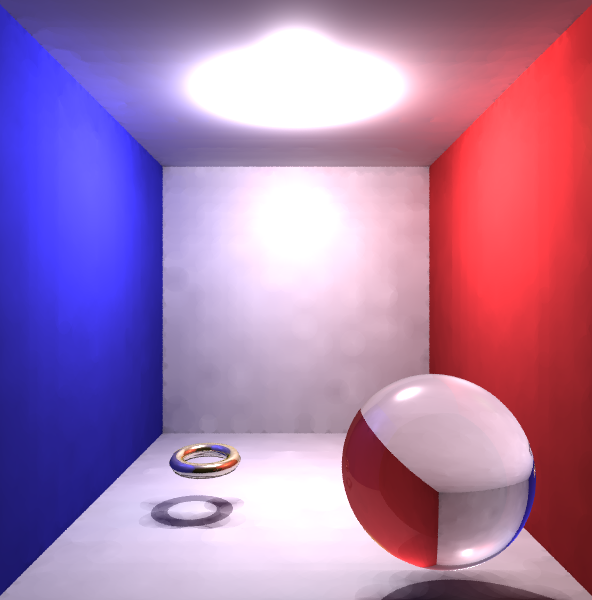

# raytrace

A ray tracer with photon mapping, written in Rust. It is a port of a
2011 Java/Swing/JOGL course project (CSCD 570, Spring 2011).



## Features

- Whitted-style ray tracing: Phong shading, hard/soft shadows, mirror
  reflection and refraction
- Photon mapping with separate direct, indirect and caustic maps (kd-tree,
  radius search over a flattened disc)
- Triangle meshes from Wavefront OBJ/MTL, accelerated by a binned-SAH BVH, plus
  analytic spheres
- N-rooks anti-aliasing; all cores via rayon; deterministic output
- Converter for the original XML `.scene` files

## Usage

```sh
cargo build --release

# Whitted ray tracing
./target/release/raytrace render assets/scenes/box_scene.toml -o box.png

# Photon mapping
./target/release/raytrace render assets/scenes/box_test_4.toml -o box_pm.png \
    --photon-count 400000

# Convert an old XML scene
./target/release/raytrace convert legacy/scenes/box_scene.scene -o assets/scenes/box_scene.toml
```

### Viewer

```sh
cargo run --release -p raytrace-viewer -- assets/scenes/box_test_4.toml
```

An egui app with every render and photon setting. It re-renders on each change,
first as a quick low-res preview and then at full resolution, filling in
row by row. Photon maps are reused until a photon setting changes. You can
save the PNG, or write the tweaked settings back to the scene file.

Run `raytrace render --help` for all flags. Everything else (radii, exposure,
depth, background…) is set in the scene file.

## Scene format

TOML, world-space coordinates. Matrices are written as four rows.

```toml
[camera]
eye = [0.0, 0.0, 10.0]
target = [0.0, 0.0, 0.0]
up = [0.0, 1.0, 0.0]      # or: view_matrix = [[...], [...], [...], [...]]
near = 9.0                # image plane distance
far = 1000.0
window = { left = -5.47, right = 5.47, bottom = -5.0, top = 5.0 }  # on near plane

[[light]]                 # point light
position = [0.0, 6.74, -9.25]
diffuse = [0.5, 0.5, 0.5]
specular = [1.0, 1.0, 1.0]

[[object]]
mesh = "../objects/BoxRoom2.obj"   # relative to the scene file
transform = [[1,0,0,0],[0,1,0,0],[0,0,1,0],[0,0,0,1]]  # optional

[render]                  # all optional; defaults shown
height = 600              # width = 0 → follows window aspect
samples = 4
max_depth = 5
shadows = true
soft_shadows = false
reflections = true
refractions = true

[photon]
enabled = false
photons_per_light = 100000
light_power = 3300.0
radius = { direct = 1.0, indirect = 1.0, caustic = 1.0 }
exposure = { direct = 1.0, indirect = 1.0, caustic = 1.0 }
```

### OBJ/MTL extensions

- An `@sphere` line in an OBJ marks it as a perfect sphere, centered on the
  vertex mean with radius reaching the farthest vertex.
- MTL `Ir` / `It` set the reflected / transmitted fractions of light. A
  `newmtl` without `Ir` defaults to 0.3 reflectivity (the original behavior).
- Smoothing groups (`s`) are respected; files without any `s` lines are
  smooth-shaded throughout.

## Layout

```
crates/raytrace       library: scene loading, BVH, tracer, photon maps
crates/raytrace-cli   `raytrace` binary
crates/raytrace-viewer  egui interactive viewer
assets/scenes         renderable TOML scenes
assets/objects        OBJ/MTL meshes
legacy/scenes         original XML scenes
```

## Differences from the 2011 version

The port keeps the original shading model, so renders look the same. It does
fix these bugs:

- The photon emission bias and the diffuse-bounce hemisphere flip were no-ops
  (`dir.sMult(-1.0)` discarded its result). Emission is now uniform, which it
  effectively was. Bounces stay on the correct side of the surface.
- The soft-shadow basis divided by `N.z`, which gave NaN on walls facing X or Y.
  The sample disc only covered j/dim radians, and samples counted occluders
  beyond the light.
- Total internal reflection produced NaN rays; now it reflects.
- Shadow tests used a parametric `t` computed from the x component alone.
- Polygons with more than three vertices lost everything past the first
  triangle; now they are fan-triangulated.
- Photon search used the direct map's disc thickness for all three maps.
- Light positions were interpreted in camera space by the ray tracer. The
  converter moves them to world space so converted scenes match the old
  ray-traced output.

`assets/objects/glassSphere.obj` was missing from the original project. It was
recreated from `chromeSphere.obj`. Its transformed center matches the center
stored in the old scene files.
