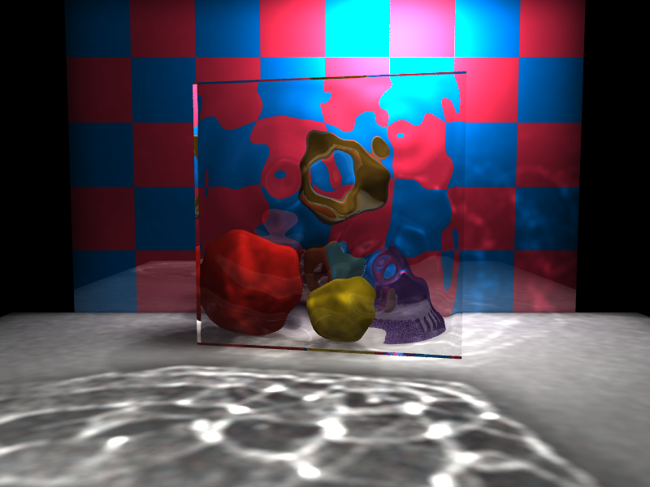
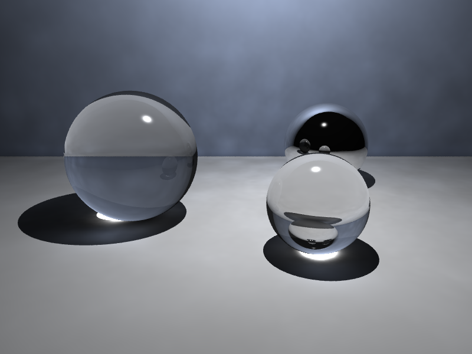
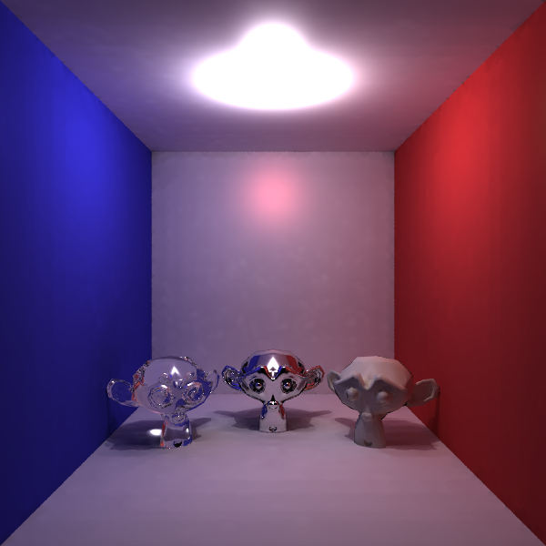
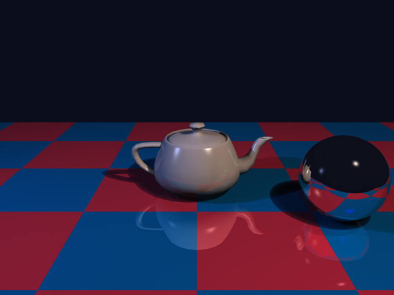
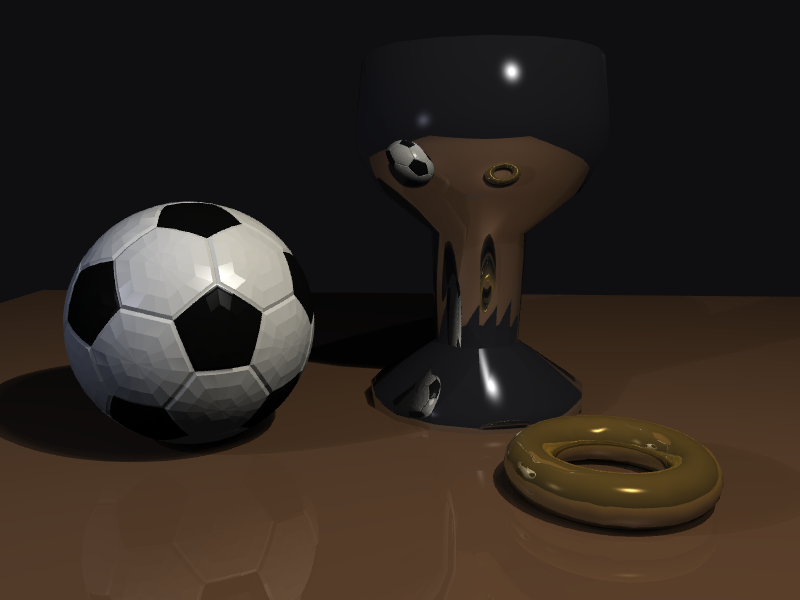
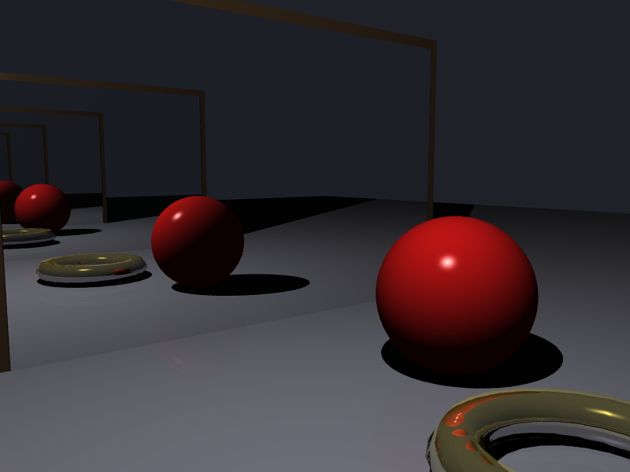
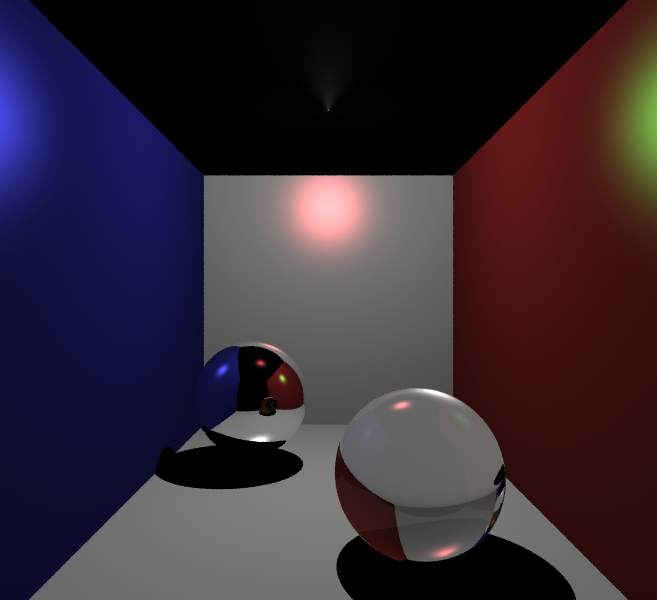

# raytrace

A ray tracer with photon mapping, written in Rust. It is a port of a
2011 Java/Swing/JOGL course project (CSCD 570, Spring 2011).


## Features

- Whitted-style ray tracing: Phong shading, hard/soft shadows, mirror
  reflection and refraction
- Photon mapping after Jensen: direct light from shadow rays, caustics from
  the caustic map, and indirect light from the indirect map or by final
  gathering over precomputed irradiance (kd-tree, k-nearest density estimates
  over a flattened disc). The 2011 direct-map shading is still available.
- Triangle meshes from Wavefront OBJ/MTL, accelerated by a binned-SAH BVH, plus
  analytic spheres
- N-rooks anti-aliasing; all cores via rayon; deterministic output
- Converter for the original XML `.scene` files

## Example scenes

All in `assets/scenes/`. The first four were converted from the 2011 project.

| | |
|---|---|
|  `ripple_glass.toml`: a rippled glass pane bending the view behind it and casting caustics (photon mapped) |  `caustics.toml`: glass focusing light (photon mapped) |
|  `monkeys.toml`: glass, chrome and plaster in the box room (photon mapped) |  `teapot.toml`: two colored lights, soft shadows |
|  `still_life.toml`: scene materials on meshes without MTL files |  `mirrors.toml`: facing mirrors, 12 bounces |
|  `box_scene.toml`: the original 2011 scene | |

Also from 2011: `box_test_4.toml`, `reflect_ring.toml`, `box_parallelepiped.toml`.

## Usage

```sh
cargo build --release

# Whitted ray tracing
./target/release/raytrace render assets/scenes/box_scene.toml -o box.png

# Photon mapping
./target/release/raytrace render assets/scenes/box_test_4.toml -o box_pm.png \
    --photon-count 400000

# Convert an old XML scene
./target/release/raytrace convert legacy/scenes/box_scene.scene -o assets/scenes/box_scene.toml
```

### Viewer

```sh
cargo run --release -p raytrace-viewer -- assets/scenes/box_test_4.toml
```

An egui app with every render and photon setting. It re-renders on each change,
first as a quick low-res preview and then at full resolution, filling in
row by row. Photon maps are reused until a photon setting changes, including
while the camera moves.

- **Camera:** drag to orbit, right-drag or shift-drag to pan, scroll to zoom.
  It shows previews while you move and does a full render once you stop.
- **Photon overlay:** draws the stored photons over the image (direct,
  indirect and caustic, each in its own color, with occluded ones hidden).
  Useful for tuning the gather radii.
- **Display:** exposure (EV) and gamma, applied at display time, so changing
  them doesn't re-render. Gamma 1.0 matches the original look.
- **Saving:** "Save PNG…" applies the display settings. "Save scene…" writes the
  current settings and camera back to TOML.

The CLI has the same display controls: `--exposure 0.5 --gamma 2.2`.

Run `raytrace render --help` for all flags. Everything else (radii, exposure,
depth, background…) is set in the scene file.

## Scene format

TOML, world-space coordinates. Matrices are written as four rows.

```toml
[camera]
eye = [0.0, 0.0, 10.0]
target = [0.0, 0.0, 0.0]
up = [0.0, 1.0, 0.0]      # or: view_matrix = [[...], [...], [...], [...]]
near = 9.0                # image plane distance
far = 1000.0
window = { left = -5.47, right = 5.47, bottom = -5.0, top = 5.0 }  # on near plane

[[light]]                 # point light
position = [0.0, 6.74, -9.25]
diffuse = [0.5, 0.5, 0.5]
specular = [1.0, 1.0, 1.0]

[[material]]              # optional; see below
name = "glass"
kd = [0.9, 0.9, 0.9]
transmissivity = 0.9      # also: ka, ks, shininess, reflectivity, ior

[[object]]
mesh = "../objects/sphere.obj"     # relative to the scene file
translate = [0.0, 1.0, 0.0]        # all placement is optional
rotate = [0.0, 45.0, 0.0]          # degrees about X, then Y, then Z
scale = 1.5                        # or [x, y, z]
material = "glass"                 # use this [[material]] for every face
# transform = [[...], ...]         # raw 4×4 rows, applied before the above

[render]                  # all optional; defaults shown
height = 600              # width = 0 → follows window aspect
samples = 4
max_depth = 5
shadows = true
soft_shadows = false
reflections = true
refractions = true

[photon]
enabled = false
photons_per_light = 100000
light_power = 3300.0
direct_lighting = "rays"   # or "map": read the direct photon map, as in 2011
radius = { direct = 1.0, indirect = 1.0, caustic = 1.0 }   # max search radius
gather = { direct = 200, indirect = 200, caustic = 80 }    # nearest photons; 0 = all in radius
exposure = { direct = 1.0, indirect = 1.0, caustic = 1.0 }
final_gather = 0           # gather rays per shading point; 0 = read the indirect map
```

Each map's estimate uses the `gather` nearest photons, out to `radius` at
most, so it sharpens where photons are dense (caustics) and widens where they
are sparse. With shadow rays the direct map is not read; `exposure.direct`
scales the shadow-ray light instead.

`final_gather` replaces the blotchy indirect map with rays over each visible
point's hemisphere. Where they land, irradiance comes from points precomputed
at every fourth photon from all three maps, using the indirect radius and
count. It is smooth and shows color bleeding, but rooms with a small, very
bright patch (like a light just under the ceiling) need around 1000 rays to
avoid speckle. `--final-gather N` sets it from the CLI.

### Materials

A scene `[[material]]` replaces any MTL material with the same name in every
mesh, or applies to a whole object through `material = "name"`. Unset fields
default to matte gray (kd 0.8, ks 0.3, shininess 32, no reflection or
transmission, ior 1.5).

`assets/objects/sphere.obj` (a unit sphere) and `quad.obj` (a 2×2 floor in
the XZ plane) are handy building blocks. Several of the old meshes are
modeled Z-up (the teapot, the checker planes) or facing +Y (the monkey head)
and need a `rotate`.

### OBJ/MTL extensions

- An `@sphere` line in an OBJ marks it as a perfect sphere, centered on the
  vertex mean with radius reaching the farthest vertex.
- MTL `Ir` / `It` set the reflected / transmitted fractions of light. A
  `newmtl` without `Ir` defaults to 0.3 reflectivity (the original behavior).
- Smoothing groups (`s`) are respected. Files without any `s` lines are
  smooth-shaded except at edges sharper than 60°. Faces are matched by
  vertex position, so meshes that duplicate vertices per face still shade
  smoothly.

## Layout

```
crates/raytrace       library: scene loading, BVH, tracer, photon maps
crates/raytrace-cli   `raytrace` binary
crates/raytrace-viewer  egui interactive viewer
assets/scenes         renderable TOML scenes
assets/objects        OBJ/MTL meshes
crates/raytrace/examples  mesh generators (`cargo run -p raytrace --example ripple_glass -- assets/objects`)
legacy/scenes         original XML scenes
```

## Differences from the 2011 version

Photon-mapped scenes now default to shadow rays for direct light and k-nearest
gathering. `direct_lighting = "map"` with every `gather` count at 0 reproduces
the original shading. The port also fixes these bugs:

- The photon emission bias and the diffuse-bounce hemisphere flip were no-ops
  (`dir.sMult(-1.0)` discarded its result). Emission is now uniform, which it
  effectively was. Bounces stay on the correct side of the surface.
- The soft-shadow basis divided by `N.z`, which gave NaN on walls facing X or Y.
  The sample disc only covered j/dim radians, and samples counted occluders
  beyond the light.
- Total internal reflection produced NaN rays; now it reflects.
- Shadow tests used a parametric `t` computed from the x component alone.
- Polygons with more than three vertices lost everything past the first
  triangle; now they are fan-triangulated.
- Photon search used the direct map's disc thickness for all three maps.
- Light positions were interpreted in camera space by the ray tracer. The
  converter moves them to world space so converted scenes match the old
  ray-traced output.

`assets/objects/glassSphere.obj` was missing from the original project. It was
recreated from `chromeSphere.obj`. Its transformed center matches the center
stored in the old scene files.
